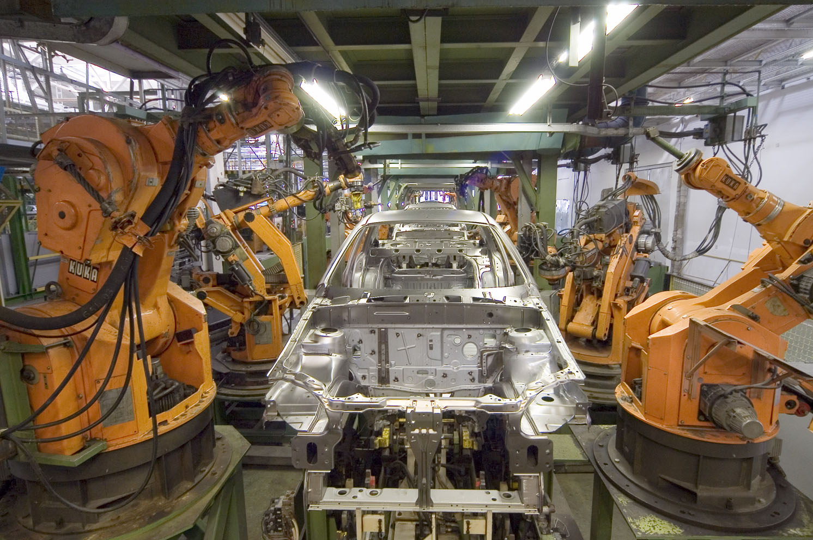

# Chirag Malkan

**OT/ICS Cybersecurity · Secure Product Development · Applied AI**

I help industrial product teams build security in and show the evidence for it.

---

## About

I run **[Malkan Solutions](https://www.malkansolutions.com)**, an OT/ICS cybersecurity consultancy. I work with manufacturers of industrial and connected products on:

- **IEC 62443** secure development lifecycle (4-1) and component security (4-2)
- **EU Cyber Resilience Act** readiness: processes, technical documentation and vulnerability reporting
- **OT risk assessment**, asset visibility and network segmentation

I also teach ethical hacking and organize **MOCS**, a regional OT cybersecurity conference.

## Credentials

- **MIT xPRO:** Technology and Innovation Acceleration Program, certificate (2022)
- **InfraGard:** Member, Wisconsin Members Alliance

## Selected projects

| Project | What it does | Stack |
| :--- | :--- | :--- |
| **[OTSniffer](https://github.com/cmalkan/OTSniffer)** | OT cyber-risk simulation: asset views, attack paths, blast-radius analysis and explainable risk scoring. | JavaScript · TypeScript · Python · Netlify |
| **[i4Things](https://github.com/cmalkan/i4Things)** | Prototype for finding misplaced items with TensorFlow, with camera validation tooling and a CycloneDX SBOM. | Python · TensorFlow · Jupyter |
| **[GoldenEagleConference](https://github.com/cmalkan/GoldenEagleConference)** | Website for the Golden Eagle Conference. | HTML · CSS · JavaScript |

## Focus areas

- **Industrial cybersecurity:** IEC 62443, CRA compliance, asset visibility and exposure analysis
- **Security evidence:** SBOMs, secure development records and audit-ready documentation
- **Risk communication:** network graphs, scenario comparisons and clear dashboards
- **Applied AI:** computer vision and practical prototypes

## Connect

For consulting and collaboration, reach me on **[LinkedIn](https://www.linkedin.com/in/chiragmalkan)** or through **[Malkan Solutions](https://www.malkansolutions.com)**.

---

Header photo: <a href="https://commons.wikimedia.org/wiki/File:KUKA_Industrial_Robots_IR.jpg">KUKA Industrial Robots</a> by Mixabest, <a href="https://creativecommons.org/licenses/by-sa/3.0/">CC BY-SA 3.0</a>, via Wikimedia Commons.
